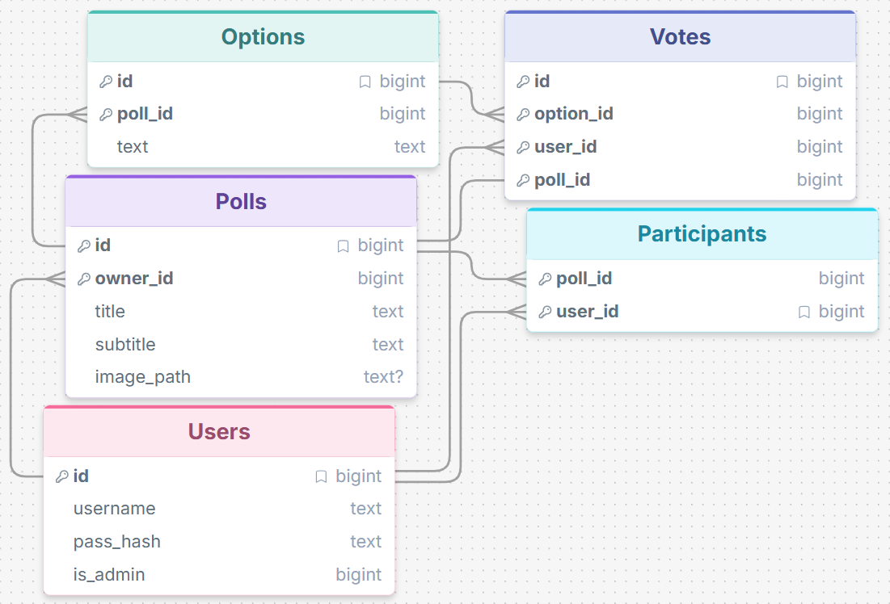
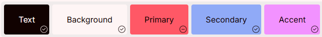
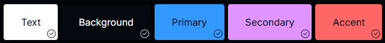
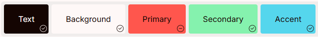
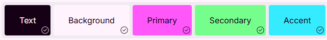
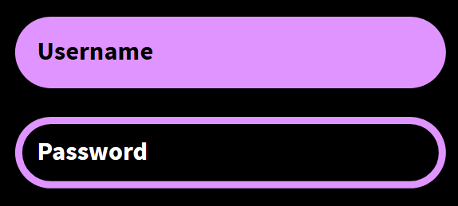

# Sprint 1 - Developing a DB and UI Prototype

## Sprint Goals

Develop a design for the database and a UI prototype that simulates the key functionality of the system. Test and refine the UI so that it can serve as the model for the next phase of development in Sprint 2.

### Specific Goals

**Edit these goals as needed**

- Design the database:
    - Tables
    - Fields / types
    - Primary keys
    - Default / nullable values
    - Relationships (foreign keys)
- Design the UI
    - Key pages
    - User interactions and 'flow'
    - Page layouts / features
    - Colour palette
    - Etc.

## Initial Database Design

Replace this text with notes regarding the DB design.

### Required Data Input

Sign Up / Login
 - Username
 - Password
 - Other details?

 Polls
 - Votes

 Creating Polls
 - Title
 - Options

### Required Data Output

Poll data
 - Poll Title
 - Poll Options
 - Votes

 Profile
 - Username
 - Details
 - Created Polls (for creators)

### Required Data Processing

Password Hashing for security and privacy.

Votes will be organised for viewing and a graph or chart will be generated to show the data.

## UI 'Flow'

I created a very minimal site example to test how the website will 'flow' between pages and actions.

[UI Flow Version 1 (1)](https://design.penpot.app/#/view?file-id=f0485fb1-4e63-8165-8008-3908c56b0abb&page-id=f0485fb1-4e63-8165-8008-3908c56b0abc&section=interactions&index=0&share-id=bd31e32d-d69f-81e2-8008-638bafe70da5)

### Testing

After testing thoroughly with my end user they wanted these changes:
 - Add Create option to creator profile (And all pages for the creator).
 - Add comments to the public polls.
 - Add a way for creators to see polls other people have made.
 - Group the User and Creator logins to improve smoothness
 - Add a log in instead button.

### Changes / Improvements

I attempted to implement the suggested features in the most effective way possible for the improved version and I was able to include every change.

*For the Login page, there are two seperate buttons for creator and user, these will be merged in the full site where code will be implemented to differentiate account types. I will also likely change how the signup page handles creators in the refined UI.

[UI Flow Version 2 (2)](https://design.penpot.app/#/view?file-id=20bdb21e-17d3-8193-8008-446ea443d562&page-id=f0485fb1-4e63-8165-8008-3908c56b0abc&section=interactions&index=0&share-id=2be68822-842f-8175-8008-661a63830092)

I tested this updated version with my end user and they said:

> "I like this layout, it is easy to navigate. The change to the opening Login page does make it look more clean and the added information on the polls created page is good with the inclusion of analytics."

## Initial UI Prototype

I improved the design significantly, making small changes in order to preserve the feel of the website.

[UI Prototype Version 1 (3)](https://design.penpot.app/#/view?file-id=a1a9e568-e174-80fb-8008-5d14c953a045&page-id=f0485fb1-4e63-8165-8008-3908c56b0abc&section=interactions&frame-id=b2324e0b-83f6-804f-8008-5d14e1d7e81e&index=14)

### Testing

When I tested my prototype with my end user, they didn't like the way the creator pages were laid out and thought that the Analytics and Results pages were too similar to keep seperate.

They also thought that rather than a 'Create new poll' button, I should add a plus instead which keeps the site cleaner.

And they also told me that I should rearrange my pages so that the create tab is not on the same section as the public polls.

### Changes / Improvements

Replace this text with notes any improvements you made as a result of the testing.

[UI Prototype Version 2 (4)](https://design.penpot.app/#/view?file-id=3be9e5e1-190f-8090-8008-6f2300a180b8&page-id=f0485fb1-4e63-8165-8008-3908c56b0abc&section=interactions&frame-id=b2324e0b-83f6-804f-8008-5d14e1d7e81e&index=13)

## Refined UI Prototype

Refining my site through Colour and Design.

After some choosing, I came up with 4 possible colour schemes implimenting vibrant colours for the options and charts:

Based on the UI prototype colours which my end user liked.

A darker variation of the original red blue and purple.

Red Blue and Green Option.

Blue Green and Purple Option

I showed these options to my end user and they liked the second option the best and thought that the default darker theme would make the colours pop more.

### Testing

For this design process I made sure to comunicate with my end user during the colouring so that they had input before the final product.

I had two differring colouring ideas for the text inputs and so I asked my end users which one they prefferent and they told me that they much preffered the first (solid colour) option.

### Changes / Improvements

I changed little to no design elements and simply recolored the design, consistently checking my in with my end user to ensure they were happy with the implementation of colour.

[Colour Prototype Version 1 (5)](https://design.penpot.app/#/view?file-id=81f57451-85cc-819d-8008-774ef6116344&page-id=f0485fb1-4e63-8165-8008-3908c56b0abc&section=interactions&index=0&share-id=c269caa0-e456-818c-8008-8b4cf0c3088d)

## Sprint Review

I think that this sprint went well, I was able to iterate and improve upon my original idea for the web app and I am happy with the result. Talking with my end-user allowed me to make regular refinements and create a finished product that my end-user is happy with.