# Sprint 2 - Implement Database and Display of Test Data

 
## Sprint Goals

Implement the database, populated with test data. Create queries that retrieve test data, and display this on web pages as needed. Test and refine the queries and data display, so that it stands as the basis of the next sprint.

### Specific Goals

- Implement the database
- Add test data to the database
- Create the following web pages:
    - Home pages showing polls, options, votes and comments
    - Login/Signup pages
- Develop SQL database queries to:
    - Retrieve all required data for displaying
    - Retrieve specific account data for authentication (password hashes, usernames, ect)

## Testing DB Implimentation & Test Data

I tested each table and their respective test data as I implemented them, ensuring each configured and seeded correctly.

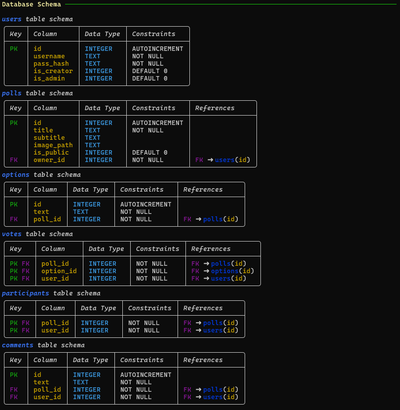

Database tables and entries configuring correctly.

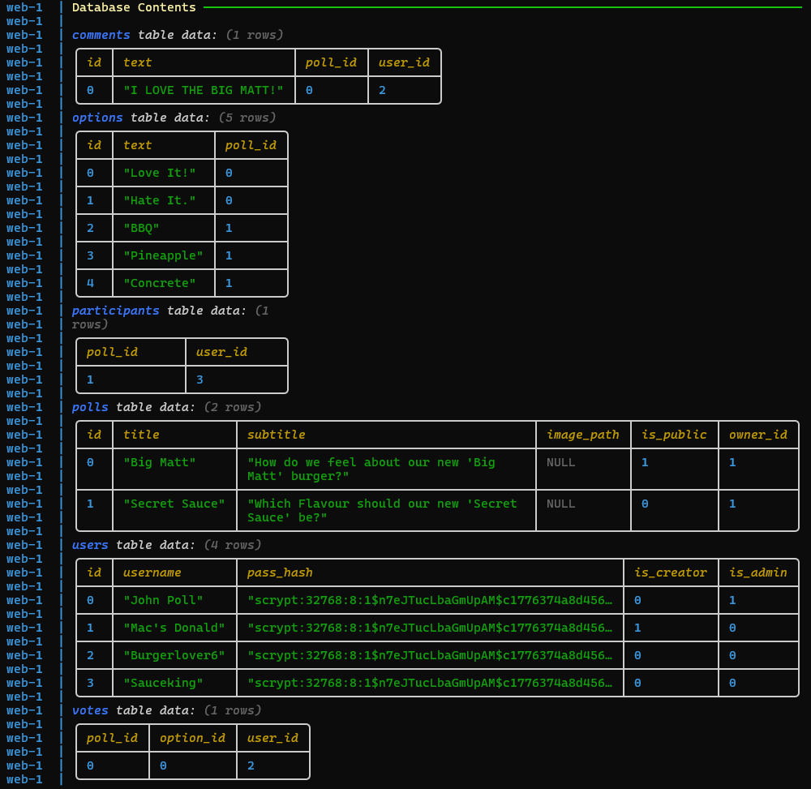

Seed data inserted into the tables correctly with at least one entry for each table to ensure each works correctly.

## Testing Display Data

After implementation of the database, I tested that displaying the data would work using SQL 'SELECT' queries.

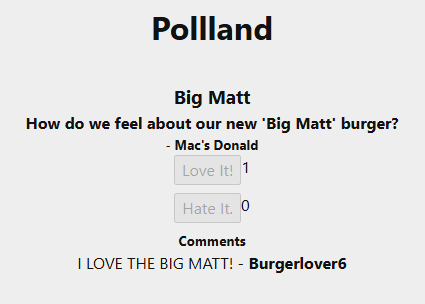

Select Queries working allowing the display of test data on the home page.

Logged in as 'Sauceking', the participant (only one able to view) of the second poll:

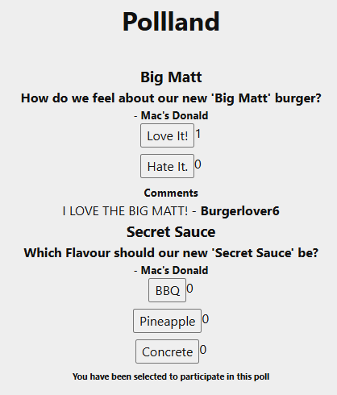

Showing that jinja/python is working on the page using test data from the queries.

## Testing Inserting User Data

Testing out creating an account using SQL 'INSERT' queries

Data Input

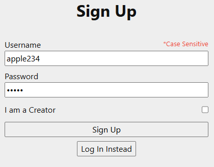

Root / Queries

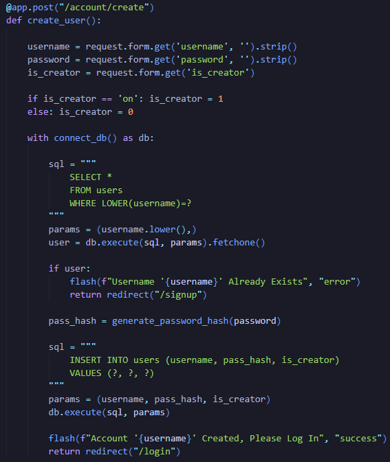

Output of the python script showing that the SQL queries were successful and the account was inserted into the database to be used later 

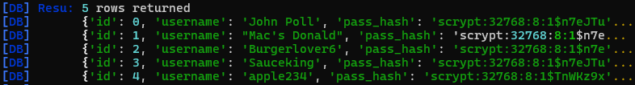

Testing login using the new account.

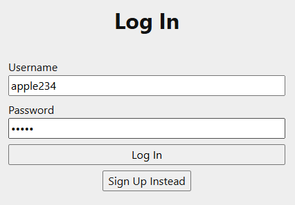

Root / Queries for login

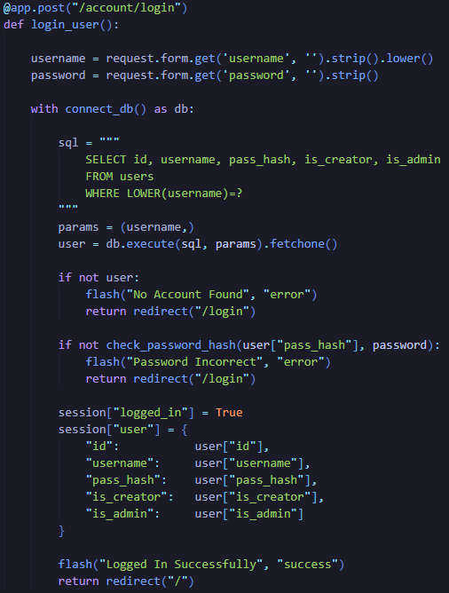

The login was successful showing all queries for both roots work correctly and interact with the database in the right way, inserting and then later selecting that new data.

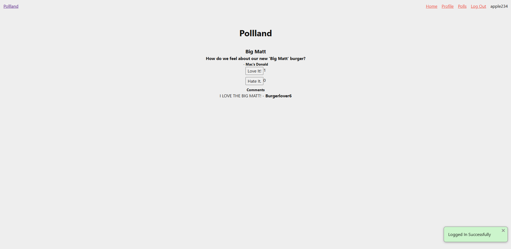

## Testing Deleting User Data

Testing deleting votes from polls (with debug text) using a SQL 'DELETE' Query.

Route and Query.

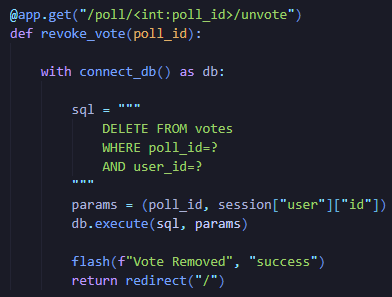

Gif of deleting vote.

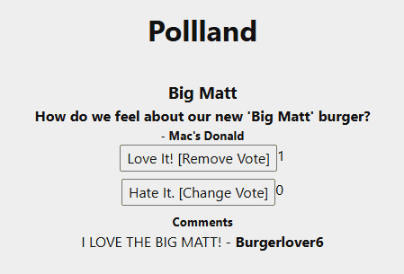

The vote is successfully removed from the votes table in the database and is shown to be removed as the vote count drops and the button text changes

## Sprint Review

This sprint was an overall success as I ensure that all my primary queries and database interactions worked correctly, testing multiple times as I added additional queries or roots, this should give me a good baseline to start my next sprint and complete the full functionality of the web app.

