# Sprint 4 - Developing a Refined and Complete System

## Sprint Goals

Develop the system until it is fully featured, with a refined UI and it satisfies the requirements. The system will be fully tested at this point.

### Specific Goals

- Refine the design and UI of the website
- Refine the user experience (UX) of the system
- Perform final, full-system testing

## Testing HTML Validation

To ensure that my website works as well I put each page of my html through a validator to ensure that it met standards and had no issues that would impact the User Experience.

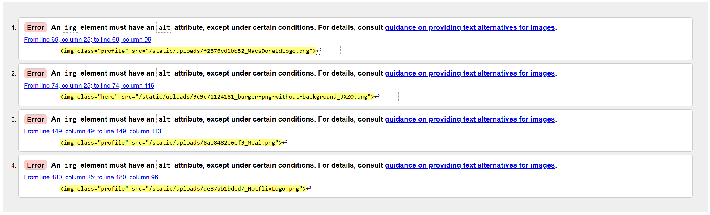

### Changes / Improvements

Every page has few issues that I fixed easily however each page had issues with the alts of images for when images fail to load or for page readers, including them is important for the User Experience, I went through each instance of an image across the site and made sure to add an alt to each of them.

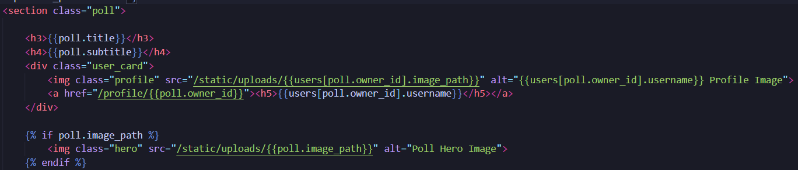

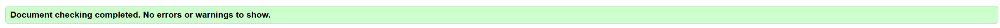

After I made this change, my html met all standards and it ensured that there were no major issues with my user experience.

## Testing Pie Charts

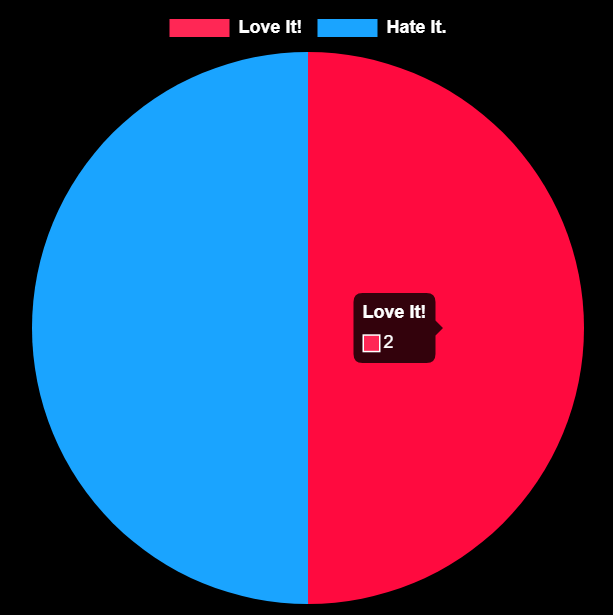

For implementing the pie charts, it was difficult but it works correctly and I went to show it to my end user who loved the way it turned out except the fact that the colours of the poll did not match the theme of the website.

### Changes / Improvements

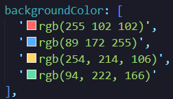

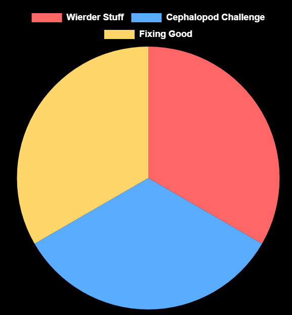

I updated this by adding 4 possible colours that fit with the theme of the website so that the pie charts fitted more and looked better for the users, I tested this change with my end user and they liked the result.

## Testing Vote Buttons 

One of the important implementations to be made of the UI was the vote buttons, in the original plan they would be coloured based on the colours in the pie chart unfortunately as I was unable to do this I talked with my end-user and they agreed it would work with just the simple purple.

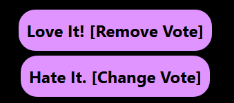

### Changes / Improvements

Once I did this I went back to my end-user and talked with them about how the buttons should display their vote-states, they suggested that I reduce the opacity of the non voted buttons.

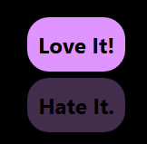

Going back to my end-user again with this new change, they thought that the (0.3) opacity was far too low and difficult to read, so I decided to change it to (0.5) opacity.

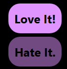

My end-user was happy with this change and It is a useful update as it improves the User Experience by ensuring that the buttons are easy to read and understand for my users rather then much more direct but less cluttered which updated now looks much better.

## Testing Images (Capping Image size), (Profile Images)

For the image implementation of the site I decided to include the creators profile image above each poll and the commenter profile image beside each comment, which I tested with my end-user and they said they liked the way it looked.

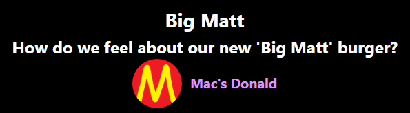

However when testing and showing off the home page UI, we found that the poll images were scaled massively and if they were too big they would take up entire pages, which overall didn't look and forced the user to scroll much more causing issues with the User Experience.

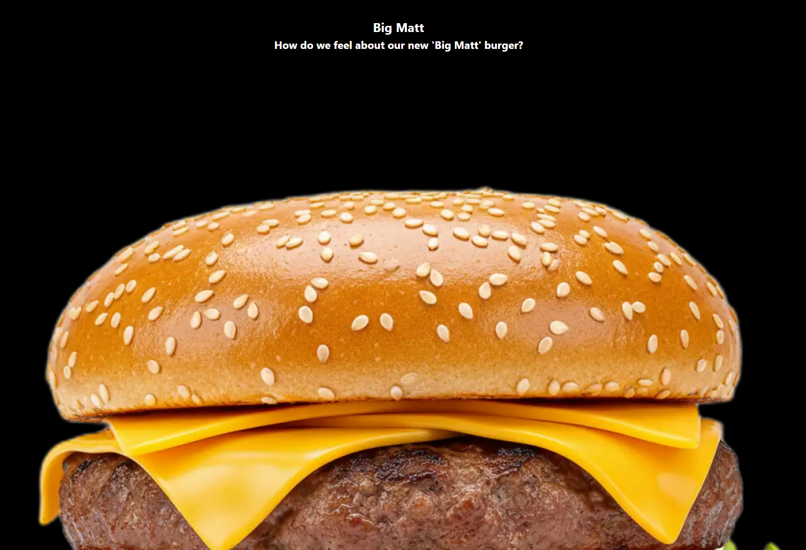

### Changes / Improvements

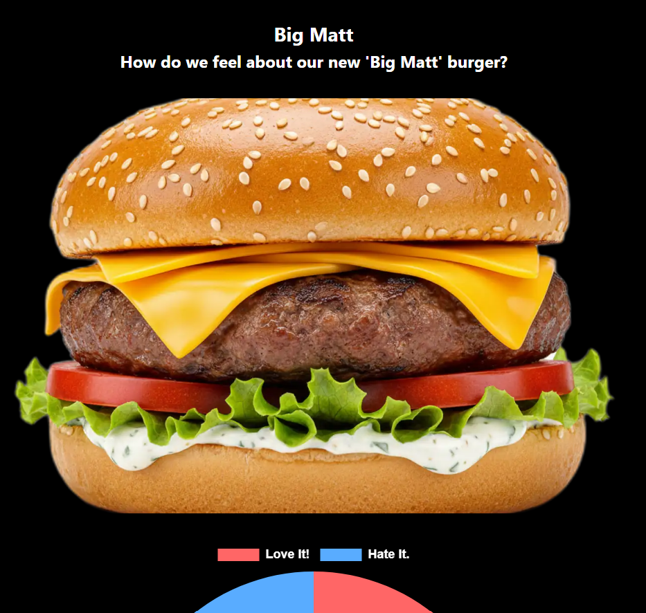

I fixed this by limiting the overall width of the image and making it automatically crop to the requirements which though occasionally cutting parts off was much better for the User Experience and testing again with my end-user they agreed with the change.

## Testing Button/Input Colours

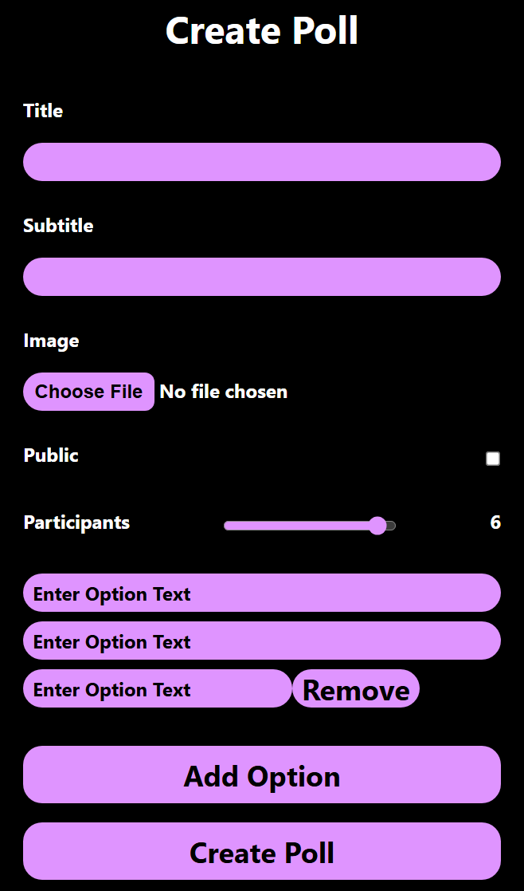

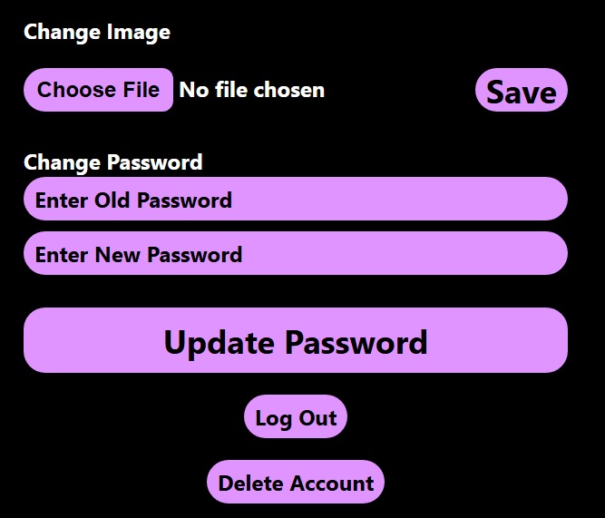

Whilst going through my forms, I found that the purple became too repetitive and unintuitive for users and when I talked about this with my end-user, they agreed. I decided to match the original design plan with blues and reds, and my end-user and I decided to go with blue for the more complex inputs that added things to the form and red for the more negative options such as delete or logout. This change would improve the user experience as it makes the forms more variable and more intuitive using standardized colours for positive/negative.

### Changes / Improvements

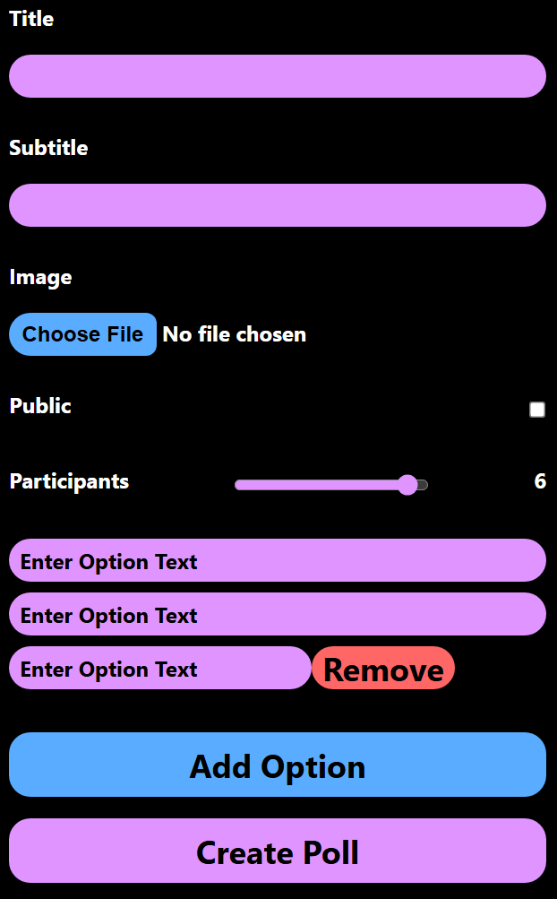

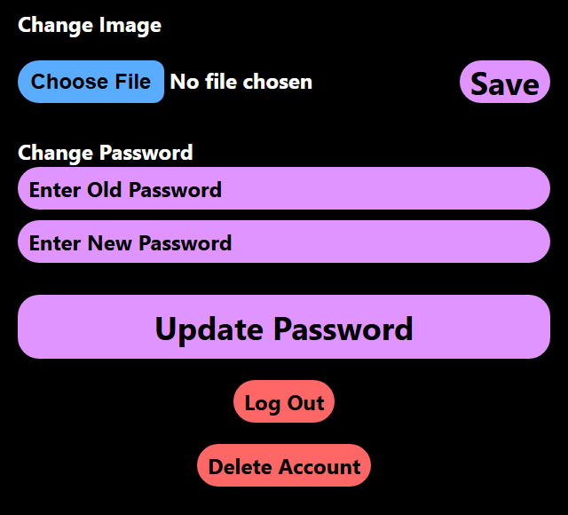

Showing the final updated forms to my end-user, they liked the change and agreed that it improves the user experience of the site.

## Testing Mobile View and Buttons

For the accessability of my site for mobile users

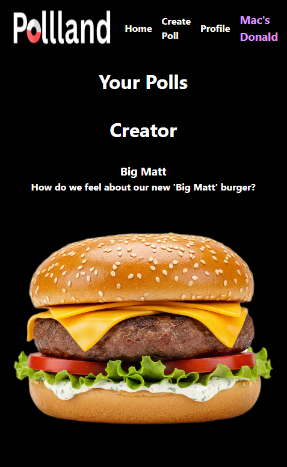

### Changes / Improvements

To update the mobile view, I mostly stuck with the original UI design with the buttons down the bottom of the screen for mobile users to ensure that they have a good User Experience rather than squished sections and hard to press buttons which would make the web app much less accessible for users on smaller/mobile devices. A small change I made was with the functionality of the buttons to match more with the layout of the web pages.

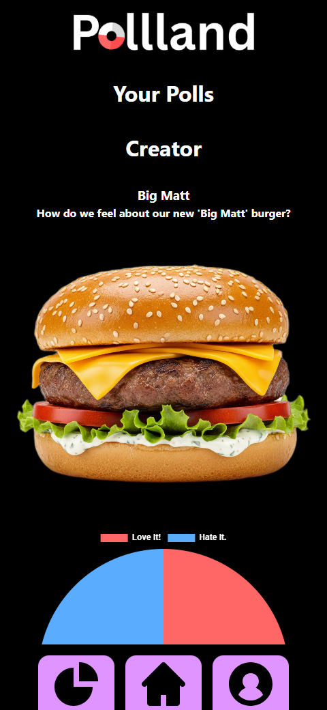

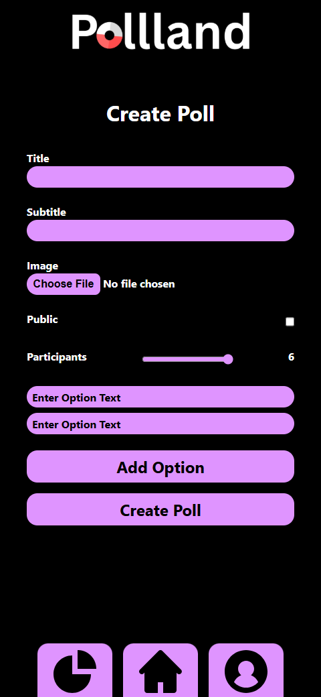

Showing this to my end-user they thought it worked well and looked good, even if it slightly deviated from the original plan of the UI functionality.

## Final Testing

I went through with my end-user for a final full test to ensure that the web app was perfectly functional and met the requirements set by the end-user. Overall we found that the web app worked well and met all the functionality requirements set, and my end-user also liked the way it looked. One issue we did find was with the change password function which I was able to fix and now everything works well.

## Sprint Review

Overall I think that this sprint went well, the final product looks good and is well designed with the users in mind and end-user is happy with the way the web app turned out. We have made many considerations based on the User Experience in order to ensure that the web app is efficient, comfortable and easy to use for all users.